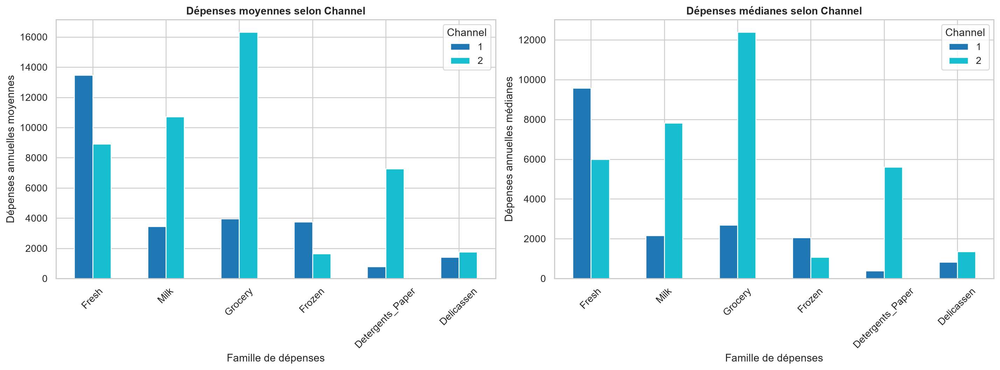

# Customer Segmentation using Unsupervised Machine Learning

**Segmentation intelligente des clients d'un distributeur en gros — étude comparative de K-Means, CAH et DBSCAN**

Projet académique de **Machine Learning 2** réalisé dans le contexte de la formation d'ingénieurs de l'ENSAM Rabat.

## Project Overview

Un distributeur en gros peut servir des commerces, des hôtels ou des restaurants ayant des profils d'achat différents. L'objectif de ce projet est d'identifier des groupes de clients aux comportements de dépenses similaires, puis de comparer plusieurs méthodes de clustering.

La problématique est formulée en apprentissage non supervisé : les groupes de clients ne sont pas connus à l'avance. Les segments obtenus pourront aider à structurer l'analyse commerciale, à comparer des profils d'achat et à préparer des stratégies adaptées. Ils ne constituent pas automatiquement des décisions commerciales ou une relation causale.

Le projet compare conceptuellement puis, dans une étape ultérieure, K-Means, la classification ascendante hiérarchique (CAH) et DBSCAN.

### Project status

Les étapes d'initialisation, de compréhension du dataset et d'analyse exploratoire sont terminées. Le prétraitement et l'implémentation des algorithmes de clustering sont à venir. Aucun modèle n'est encore entraîné et aucun score de clustering n'est publié.

## Dataset Description

Le dataset utilisé est **Wholesale Customers**, disponible dans le [UCI Machine Learning Repository — dataset 292](https://archive.ics.uci.edu/dataset/292/wholesale+customers). Il contient **440 observations** et **8 colonnes**.

| Variable | Description | Nature dans l'analyse | Rôle prévu |
|---|---|---|---|
| Channel | Canal commercial codé | Catégorielle, malgré le stockage en int64 | Interprétation |
| Region | Région du client codée | Catégorielle, malgré le stockage en int64 | Interprétation |
| Fresh | Dépenses annuelles en produits frais | Numérique quantitative | Clustering initial |
| Milk | Dépenses annuelles en produits laitiers | Numérique quantitative | Clustering initial |
| Grocery | Dépenses annuelles en épicerie | Numérique quantitative | Clustering initial |
| Frozen | Dépenses annuelles en produits surgelés | Numérique quantitative | Clustering initial |
| Detergents_Paper | Dépenses annuelles en détergents et papier | Numérique quantitative | Clustering initial |
| Delicassen | Dépenses annuelles en produits delicatessen | Numérique quantitative | Clustering initial |

Les six variables de dépenses seront utilisées pour le clustering initial. Channel et Region seront conservées pour interpréter les profils obtenus. Aucune unité monétaire n'est supposée ou ajoutée.

## Project Architecture

~~~text
ML2-Customer-Segmentation/
├── data/
│   ├── raw/
│   │   └── Wholesale customers data.csv
│   └── processed/
├── notebooks/
│   ├── 01_dataset_understanding.ipynb
│   └── 02_exploratory_data_analysis.ipynb
├── results/
│   ├── figures/
│   │   ├── 01_histogrammes_kde_depenses.png
│   │   ├── 02_boxplots_depenses_iqr.png
│   │   ├── 03_heatmap_correlations_depenses.png
│   │   ├── 04_scatterplots_relations_depenses_channel.png
│   │   ├── 05_repartition_channel_region.png
│   │   └── 06_comparaison_depenses_par_channel.png
│   └── tables/
├── reports/
├── src/
│   └── check_dataset.py
├── .gitignore
├── README.md
└── requirements.txt
~~~

- data/raw/ contient la copie intacte du CSV utilisé par les notebooks.
- data/processed/ est réservé aux données préparées lors d'une étape ultérieure.
- notebooks/ contient les analyses pédagogiques exécutées dans l'ordre.
- results/figures/ contient les figures finales de l'EDA utilisées dans cette documentation.
- results/tables/ et reports/ sont préparés pour les livrables futurs.
- src/ contient les scripts réutilisables, dont le contrôle initial du dataset.

## Installation and Setup

### Prérequis

- Windows PowerShell ;
- Python 3.12 ;
- Git ;
- Visual Studio Code avec l'extension Python et l'extension Jupyter.

### Installation sous PowerShell

~~~powershell
git clone https://github.com/saadshr/ml2-customer-segmentation.git
cd ml2-customer-segmentation

& "C:\Program Files\Python312\python.exe" -m venv .venv
.\.venv\Scripts\Activate.ps1

python -m pip install -r requirements.txt
~~~

Si l'activation PowerShell est bloquée pour la session courante :

~~~powershell
Set-ExecutionPolicy -Scope Process -ExecutionPolicy Bypass
.\.venv\Scripts\Activate.ps1
~~~

L'environnement peut aussi être utilisé directement sans activation :

~~~powershell
& ".\.venv\Scripts\python.exe" -m pip install -r requirements.txt
& ".\.venv\Scripts\jupyter.exe" notebook
~~~

Dans VS Code, sélectionner l'interpréteur .venv\Scripts\python.exe, puis le kernel Python 3.12 (.venv) dans chaque notebook.

## Execution Order

Depuis la racine du dépôt :

~~~powershell
& ".\.venv\Scripts\python.exe" src\check_dataset.py
& ".\.venv\Scripts\jupyter.exe" nbconvert --to notebook --execute --inplace notebooks\01_dataset_understanding.ipynb
& ".\.venv\Scripts\jupyter.exe" nbconvert --to notebook --execute --inplace notebooks\02_exploratory_data_analysis.ipynb
~~~

Les commandes d'exécution conservent les sorties dans les notebooks. Le CSV de data/raw/ n'est jamais modifié.

## Machine Learning Pipeline

~~~mermaid
flowchart LR
    A[Dataset] --> B[Data Understanding ✅ terminé]
    B --> C[EDA ✅ terminée]
    C --> D[Preprocessing ⏳ à venir]
    D --> E[Clustering ⏳ à venir]
    E --> F[Evaluation ⏳ à venir]
    F --> G[Customer Profiling ⏳ à venir]
    G --> H[Conclusions ⏳ à venir]
~~~

## Algorithms

| Méthode | Principe | Atout attendu | Point d'attention |
|---|---|---|---|
| **K-Means** | Affecte les observations à k centroïdes en minimisant l'inertie intra-cluster. | Simple et efficace pour des groupes compacts. | Nécessite de choisir k et est sensible à l'échelle et aux valeurs extrêmes. |
| **CAH** | Construit progressivement une hiérarchie de fusions entre observations ou groupes. | Permet d'examiner une structure hiérarchique. | Le choix de la liaison et de la distance influence le résultat. |
| **DBSCAN** | Forme des groupes à partir de zones denses et identifie le bruit. | Peut détecter des formes non sphériques et des points isolés. | Le choix de eps et min_samples est déterminant. |

L'implémentation et la comparaison expérimentale de ces méthodes sont prévues, mais ne sont pas encore réalisées dans le dépôt.

## Exploratory Data Analysis

L'EDA a été réalisée dans [02_exploratory_data_analysis.ipynb](notebooks/02_exploratory_data_analysis.ipynb) avec Pandas, NumPy, Matplotlib et Seaborn.

### Observations calculées

- Les six dépenses ont une moyenne supérieure à leur médiane, ce qui indique une asymétrie positive potentielle.
- Les skewness les plus élevées sont Delicassen = 11,152, Frozen = 5,908 et Milk = 4,054.
- La règle IQR signale 20 valeurs pour Fresh, 28 pour Milk, 24 pour Grocery, 43 pour Frozen, 30 pour Detergents_Paper et 27 pour Delicassen.
- Les corrélations de Pearson les plus fortes sont Grocery–Detergents_Paper = 0,925, Milk–Grocery = 0,728 et Milk–Detergents_Paper = 0,662. La corrélation négative la plus forte observée est Frozen–Detergents_Paper = -0,132.
- Channel contient 298 clients pour la modalité 1 et 142 pour la modalité 2. Les moyennes diffèrent principalement pour Grocery, Milk et Detergents_Paper.

Ces corrélations décrivent des associations linéaires et ne démontrent aucune causalité. Les valeurs extrêmes ne sont pas supprimées.

### Figures sélectionnées

## Clustering Evaluation

Les métriques prévues pour comparer les futurs modèles sont :

- **Elbow Method** : aide à examiner l'évolution de l'inertie avec le nombre de clusters ;
- **Silhouette Score** : mesure la cohésion interne et la séparation entre clusters ;
- **Davies-Bouldin Index** : évalue la similarité entre clusters, avec une valeur plus faible généralement préférable ;
- **Calinski-Harabasz Index** : compare dispersion inter-clusters et dispersion intra-clusters, avec une valeur plus élevée généralement préférable.

### Results — Coming Soon

Aucun score n'est publié à ce stade : les algorithmes et leur évaluation appartiennent aux étapes suivantes.

## Reproducibility

- Environnement recommandé : Python 3.12 dans .venv.
- Dépendances déclarées dans [requirements.txt](requirements.txt).
- Données sources : [data/raw/Wholesale customers data.csv](data/raw/Wholesale%20customers%20data.csv).
- Ordre recommandé : 01_dataset_understanding.ipynb, puis 02_exploratory_data_analysis.ipynb.
- Les fichiers générés sont enregistrés dans results/figures/.
- Un random_state devra être fixé lorsque cela est pertinent dans les futurs algorithmes ou comparaisons aléatoires.
- Les versions exactes des bibliothèques peuvent être vérifiées dans l'environnement virtuel ; elles ne sont pas inventées dans ce README.

## Limitations and Future Work

Le dataset décrit un portefeuille de 440 clients avec des dépenses annuelles, mais ne fournit pas toutes les informations métier nécessaires pour expliquer les comportements. Les variables catégorielles sont codées et servent ici principalement à l'interprétation. Les dépenses présentent des échelles et des asymétries différentes, ainsi que des valeurs potentiellement extrêmes.

Les prochaines étapes sont :

1. étudier et comparer des stratégies de prétraitement, sans modifier le CSV source ;
2. évaluer l'effet éventuel de log1p, StandardScaler et RobustScaler ;
3. entraîner K-Means, CAH et DBSCAN ;
4. comparer les résultats avec les métriques adaptées ;
5. profiler les segments et documenter les limites d'interprétation.

## References

- [UCI Machine Learning Repository — Wholesale Customers, ID 292](https://archive.ics.uci.edu/dataset/292/wholesale+customers)
- [Scikit-learn — Clustering](https://scikit-learn.org/stable/modules/clustering.html)
- [Scikit-learn — Clustering metrics](https://scikit-learn.org/stable/modules/clustering.html#clustering-performance-evaluation)
- [Pandas documentation](https://pandas.pydata.org/docs/)
- [Seaborn documentation](https://seaborn.pydata.org/)

## Authors

Projet réalisé par un groupe d'étudiants ingénieurs de l'**ENSAM Rabat**.

> Membres du groupe : à compléter par l'équipe.
