# Customer Segmentation Using Unsupervised Machine Learning

**Segmentation intelligente des clients d'un distributeur en gros — comparaison de K-Means, CAH Ward et DBSCAN**

[](https://www.python.org/)
[](https://scikit-learn.org/)
[](https://jupyter.org/)
[](#résultats-et-comparaison)

Projet académique du module **Machine Learning 2**, réalisé à l’**ENSAM Rabat**, filière **INDIA 2eme annee**, année universitaire **2026/2027**.

## Présentation du projet

Un distributeur en gros peut servir des clients dont les comportements d’achat sont très différents. L’objectif de ce projet est de découvrir des groupes de clients présentant des profils de dépenses proches, sans étiquette commerciale fournie à l’avance.

Le projet suit une démarche d’apprentissage non supervisé : les ressemblances sont calculées sur six catégories de dépenses annuelles, puis les groupes sont décrits dans les unités originales. `Channel` et `Region` restent hors des distances, car ce sont des variables catégorielles codées en entiers ; elles sont réservées à l’interprétation.

Les objectifs sont de :

- comprendre la structure et la qualité du dataset ;
- analyser les distributions, les valeurs extrêmes et les corrélations ;
- comparer K-Means, la CAH avec liaison Ward et DBSCAN ;
- évaluer les partitions avec des métriques adaptées à leur couverture ;
- interpréter les profils avec prudence, sans transformer les clusters en vérités commerciales.

## Dataset

Le dataset **Wholesale Customers** provient de l’[UCI Machine Learning Repository, ID 292](https://archive.ics.uci.edu/dataset/292/wholesale+customers). Il contient 440 observations et 8 variables. Aucune unité monétaire n’est inventée dans ce projet.

| Variable | Signification | Nature dans l’analyse | Rôle |
|---|---|---|---|
| `Channel` | Canal commercial codé | Catégorielle | Interprétation uniquement |
| `Region` | Région codée | Catégorielle | Interprétation uniquement |
| `Fresh` | Dépenses annuelles en produits frais | Quantitative | Distance et clustering |
| `Milk` | Dépenses annuelles en produits laitiers | Quantitative | Distance et clustering |
| `Grocery` | Dépenses annuelles en épicerie | Quantitative | Distance et clustering |
| `Frozen` | Dépenses annuelles en produits surgelés | Quantitative | Distance et clustering |
| `Detergents_Paper` | Dépenses annuelles en détergents et papier | Quantitative | Distance et clustering |
| `Delicassen` | Dépenses annuelles en produits delicatessen | Quantitative | Distance et clustering |

Le fichier original est conservé dans [`data/raw/`](data/raw/) : [`Wholesale customers data.csv`](data/raw/Wholesale%20customers%20data.csv).

## Architecture du projet

```text
ML2-Customer-Segmentation/
├── data/
│   ├── raw/
│   │   └── Wholesale customers data.csv
│   └── processed/
│       ├── customers_standard_scaled.csv
│       ├── customers_log_standard_scaled.csv
│       ├── customers_log_robust_scaled.csv
│       └── preprocessing_transformers.pkl
├── models/
│   └── kmeans_final.pkl
├── notebooks/
│   ├── 01_dataset_understanding.ipynb
│   ├── 02_exploratory_data_analysis.ipynb
│   ├── 03_data_preprocessing.ipynb
│   ├── 04_kmeans_clustering.ipynb
│   └── 05_cah_dbscan_comparison.ipynb
├── results/
│   ├── figures/                 # figures EDA, prétraitement et clustering
│   └── tables/                  # métriques, labels et profils
├── src/
│   ├── check_dataset.py
│   └── preprocessing.py
├── reports/
│   ├── ML2_customer_segmentation_overleaf.zip
│   └── latex/                   # sources, figures, tableaux et PDF du rapport
├── presentation/
│   ├── ML2_Customer_Segmentation_FINAL.pptx
│   ├── SCRIPT_SOUTENANCE.md
│   ├── QUESTIONS_REPONSES.md
│   └── GUIDE_SOUTENANCE.md
├── .gitignore
├── README.md
├── requirements.txt
└── .vscode/settings.json
```

Les anciennes versions de présentation et les scripts de génération sont conservés séparément dans [`presentation/archive/`](presentation/archive/) et exclus du versionnement par `.gitignore`.

- `data/` contient les données originales et les matrices préparées ;
- `notebooks/` contient les étapes scientifiques dans l’ordre ;
- `src/` contient les contrôles et fonctions réutilisables ;
- `results/` contient les figures et tableaux produits ;
- `models/` contient le modèle K-Means sauvegardé ;
- `reports/` contient le rapport LaTeX, son PDF et l’archive Overleaf ;
- `presentation/` contient uniquement les livrables officiels de soutenance.

## Pipeline Machine Learning

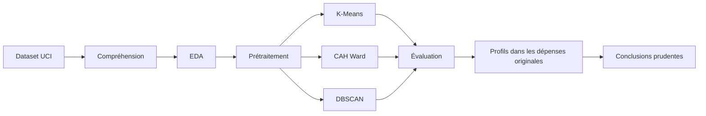

## Analyse exploratoire

Les dépenses présentent des asymétries positives a droite . La skewness de `Delicassen` atteint 11,152. La règle IQR signale 172 valeurs cumulées sur les six dépenses ; ces signalements ne correspondent pas nécessairement à 172 clients distincts et aucune observation n’est supprimée.

La corrélation de Pearson la plus forte concerne `Grocery` et `Detergents_Paper` avec `r = 0,925`. Cette association est descriptive et ne démontre pas de causalité.

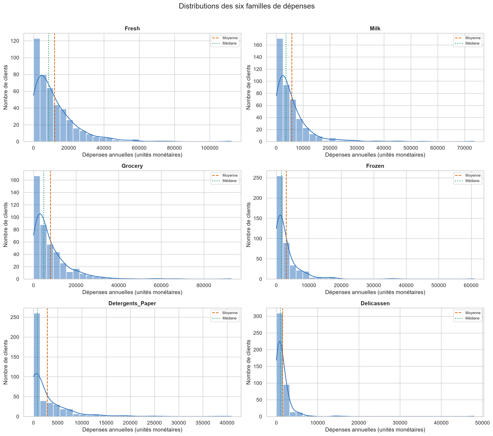

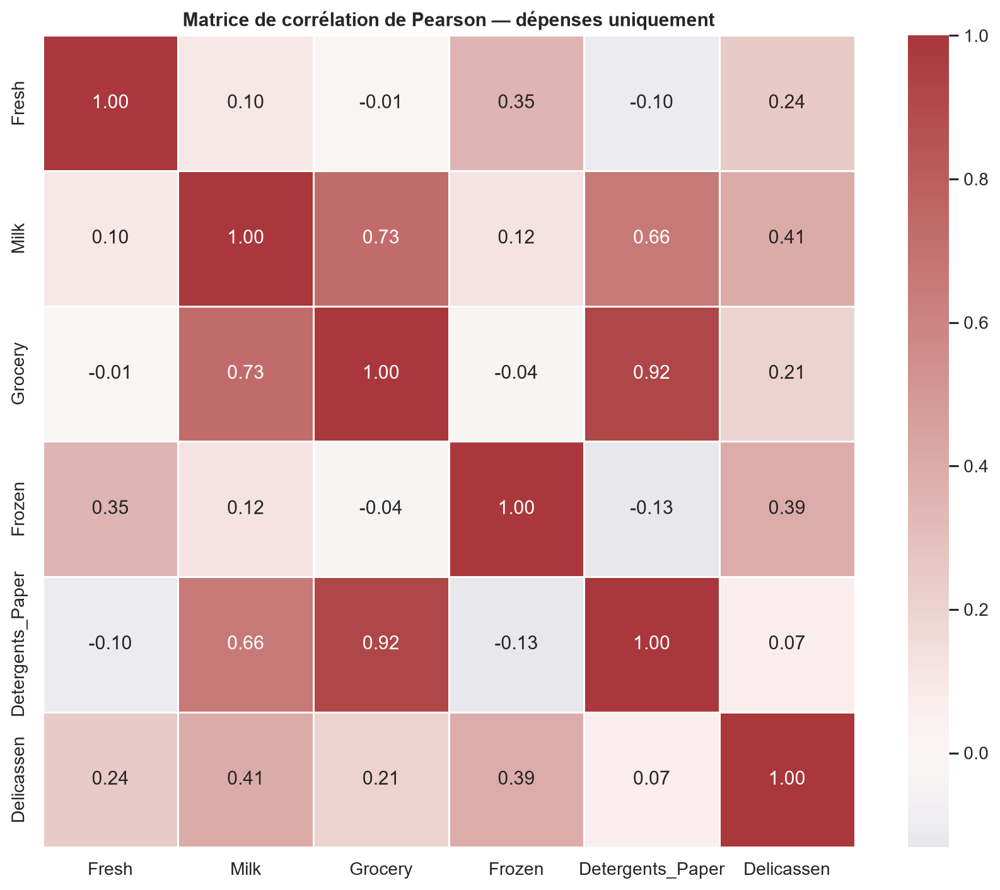

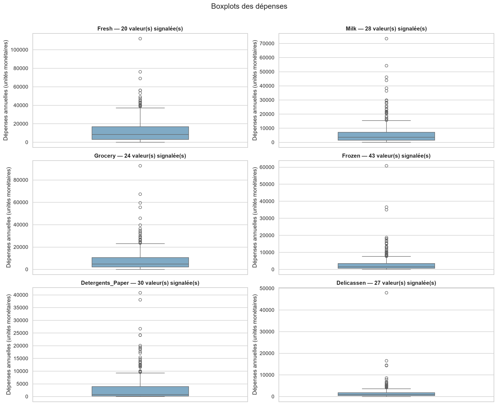

## Prétraitement

Trois stratégies ont été produites :

1. `StandardScaler` seul ;
2. `log1p` puis `StandardScaler` ;
3. `log1p` puis `RobustScaler`.

`log1p(x) = log(1+x)` compresse les grandes dépenses. `StandardScaler` centre et réduit les variables, tandis que `RobustScaler` s’appuie sur la médiane et l’IQR.

La stratégie principale est **`log1p + StandardScaler`**, car elle répond aux asymétries et aux différences d’échelle observées dans l’EDA. Elle constitue une candidate méthodologique, pas un optimum universel démontré. Les stratégies A et C restent utiles pour une analyse de sensibilité.

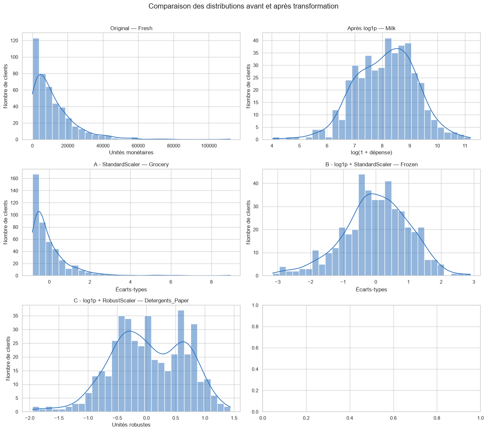

## Algorithmes

| Méthode | Principe | Paramètres ou décision | Limite observée |
|---|---|---|---|
| **K-Means** | Affectation aux centroïdes et minimisation de l’inertie | `K=2`, `init="k-means++"`, `n_init=20`, `random_state=42` | Nécessite `K` et préfère des groupes compacts |
| **CAH Ward** | Fusions hiérarchiques contrôlant l’augmentation de variance | `linkage="ward"`, recherche de `K=2` à `6` | Dépend du linkage et de la coupe |
| **DBSCAN** | Groupes selon la densité et identification du bruit | `eps=0,80`, `min_samples=5` | Sensible aux paramètres et couverture faible ici |

### K-Means

K-Means teste plusieurs valeurs de `K` avec l’initialisation K-Means++. L’Elbow suit l’inertie, tandis que la silhouette mesure la cohésion et la séparation. La PCA affichée dans le projet sert uniquement à projeter les six dimensions en deux axes ; K-Means n’est pas entraîné sur PC1 et PC2.

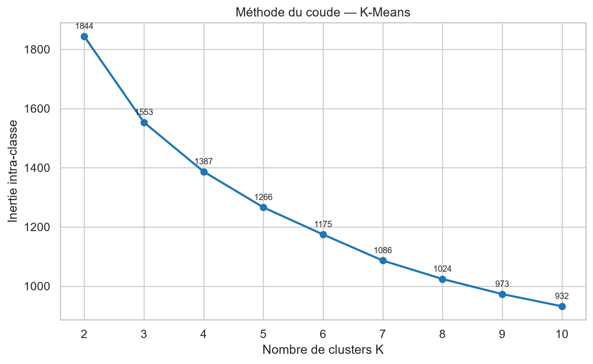

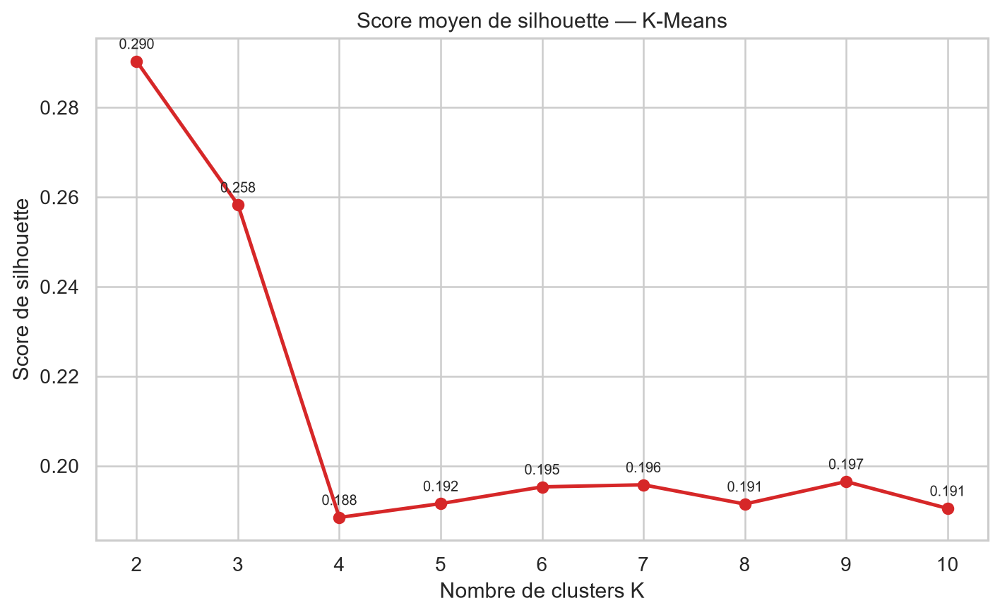

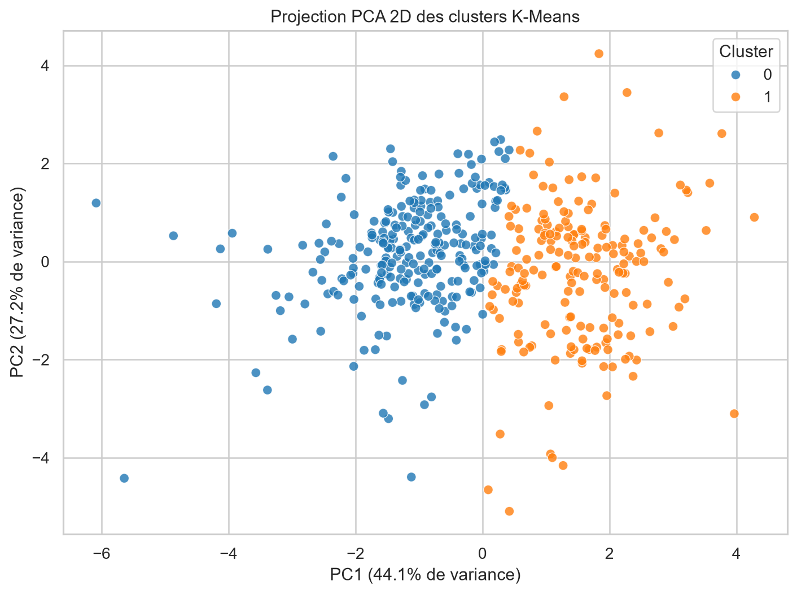

### CAH Ward

La CAH commence avec une observation par groupe et fusionne progressivement les groupes. Ward choisit les fusions qui augmentent le moins la variance intra-classe.

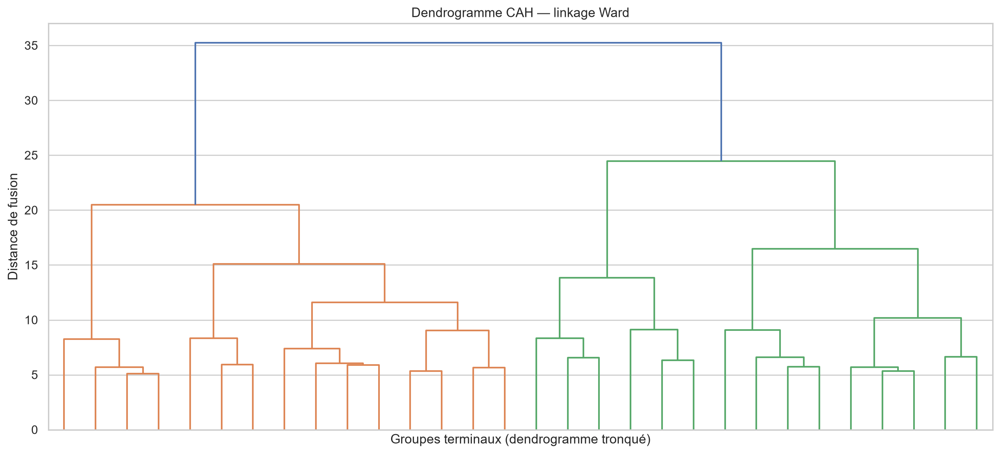

### DBSCAN

DBSCAN utilise un rayon `eps` et un seuil `min_samples`. Les points qui ne satisfont pas la densité locale peuvent être classés comme bruit.

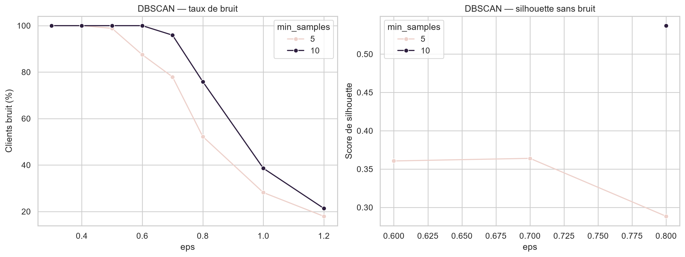

## Résultats et comparaison

Les résultats proviennent des notebooks et des tableaux exportés dans [`results/tables/`](results/tables/).

| Méthode | Clusters | Silhouette | Points évalués | Couverture | Bruit | Effectifs |
|---|---:|---:|---:|---:|---:|---|
| K-Means | 2 | 0,2903 | 440 | 100 % | 0 % | 252 / 188 |
| CAH Ward | 2 | 0,2585 | 440 | 100 % | 0 % | 178 / 262 |
| DBSCAN (`eps=0,80`, `min_samples=5`) | 3 | 0,2885* | 210* | 47,73 % | 52,27 % | 200 / 5 / 5 |

`*` La silhouette DBSCAN est calculée uniquement sur les 210 observations non bruitées. Elle n’est donc pas directement comparable aux scores K-Means et CAH, calculés sur les 440 clients.

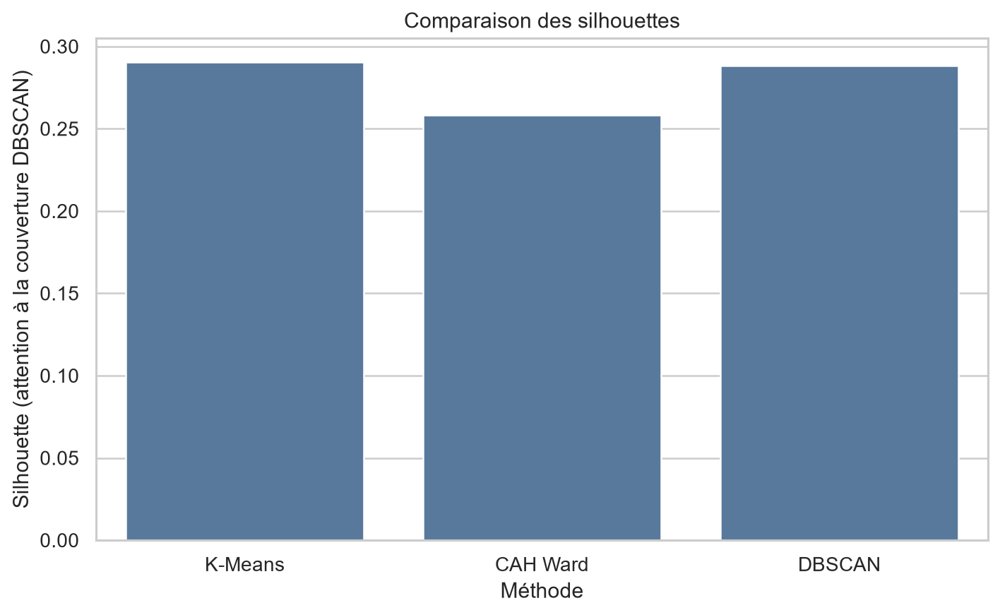

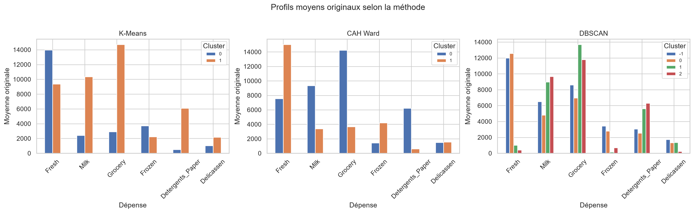

### Conclusion scientifique

Parmi les configurations testées, **K-Means représente le meilleur compromis** entre couverture complète, effectifs raisonnables, interprétabilité et silhouette complète légèrement supérieure à celle de la CAH. La séparation reste toutefois **modeste** : les groupes se recouvrent partiellement et ne doivent pas être présentés comme des segments parfaitement séparés.

DBSCAN est informatif pour étudier la densité et les observations atypiques, mais sa configuration retenue classe 52,27 % des clients comme bruit. Son score hors bruit doit donc être interprété avec prudence.

## Installation et exécution sous Windows

### Prérequis

- Windows PowerShell ;
- Python 3.12 ;
- Git ;
- VS Code avec les extensions Python et Jupyter.

### Installation

```powershell
git clone https://github.com/saadshr/ml2-customer-segmentation.git
cd ml2-customer-segmentation

py -3.12 -m venv .venv
.\.venv\Scripts\Activate.ps1
python -m pip install -r requirements.txt
```

Si l’activation PowerShell est bloquée pour la session courante :

```powershell
Set-ExecutionPolicy -Scope Process -ExecutionPolicy Bypass
.\.venv\Scripts\Activate.ps1
```

L’environnement peut aussi être utilisé directement :

```powershell
& ".\.venv\Scripts\python.exe" -m pip install -r requirements.txt
& ".\.venv\Scripts\jupyter.exe" notebook
```

Dans VS Code, choisir `.venv\Scripts\python.exe` comme interpréteur et comme kernel Jupyter.

### Ordre d’exécution

Depuis la racine du dépôt :

```powershell
& ".\.venv\Scripts\python.exe" src\check_dataset.py
& ".\.venv\Scripts\jupyter.exe" nbconvert --to notebook --execute notebooks\01_dataset_understanding.ipynb
& ".\.venv\Scripts\jupyter.exe" nbconvert --to notebook --execute notebooks\02_exploratory_data_analysis.ipynb
& ".\.venv\Scripts\jupyter.exe" nbconvert --to notebook --execute notebooks\03_data_preprocessing.ipynb
& ".\.venv\Scripts\jupyter.exe" nbconvert --to notebook --execute notebooks\04_kmeans_clustering.ipynb
& ".\.venv\Scripts\jupyter.exe" nbconvert --to notebook --execute notebooks\05_cah_dbscan_comparison.ipynb
```

Les notebooks exportent leurs résultats dans `data/processed/`, `results/` et `models/`. Le dataset original reste inchangé.

## Reproductibilité

- Python 3.12 dans l’environnement `.venv` ;
- dépendances listées dans [`requirements.txt`](requirements.txt) ;
- graine K-Means : `random_state=42` ;
- initialisation : `k-means++`, `n_init=20` ;
- données originales dans [`data/raw/`](data/raw/) ;
- matrices préparées dans [`data/processed/`](data/processed/) ;
- résultats graphiques et tabulaires dans [`results/`](results/) ;
- ordre des notebooks indiqué ci-dessus.

La reproductibilité de l’exécution ne constitue pas une étude de stabilité inter-échantillons. La stabilité des partitions reste une perspective.

## Rapport et présentation

- [Rapport final PDF](reports/latex/main.pdf)
- [Sources LaTeX](reports/latex/main.tex)
- [Archive Overleaf](reports/ML2_customer_segmentation_overleaf.zip)
- [Présentation finale de 29 diapositives](presentation/ML2_Customer_Segmentation_FINAL.pptx)
- [Script de soutenance](presentation/SCRIPT_SOUTENANCE.md)
- [Questions/réponses](presentation/QUESTIONS_REPONSES.md)
- [Guide de soutenance](presentation/GUIDE_SOUTENANCE.md)

## Limites et perspectives

- La séparation interne reste modeste.
- DBSCAN couvre moins de la moitié des clients dans la configuration retenue.
- Les résultats dépendent de l’espace préparé et des paramètres des méthodes.
- Les dépenses sont agrégées et ne décrivent pas toute la valeur client.
- La stabilité des clusters doit encore être étudiée.
- Les profils doivent être validés avec des informations métier et des actions commerciales réelles.

Ces éléments sont des limites ou des perspectives ; ils ne sont pas présentés comme des analyses déjà réalisées..

## Références

- [UCI Machine Learning Repository — Wholesale Customers](https://archive.ics.uci.edu/dataset/292/wholesale+customers)
- [Scikit-learn — Clustering](https://scikit-learn.org/stable/modules/clustering.html)
- [Scikit-learn — Évaluation du clustering](https://scikit-learn.org/stable/modules/clustering.html#clustering-performance-evaluation)
- [SciPy — Hierarchical clustering](https://docs.scipy.org/doc/scipy/reference/cluster.hierarchy.html)
- [Pandas documentation](https://pandas.pydata.org/docs/)
- [Seaborn documentation](https://seaborn.pydata.org/)

## Auteurs

Projet réalisé par :

- **Saad Sahraoui**
- **Hassan El Hajjam**

**ENSAM Rabat — Filière INDIA**  
**Module : Machine Learning 2**  
**Encadrante : Pr. Safaâ Dafrallah**  
**Année universitaire : 2026/2027**
