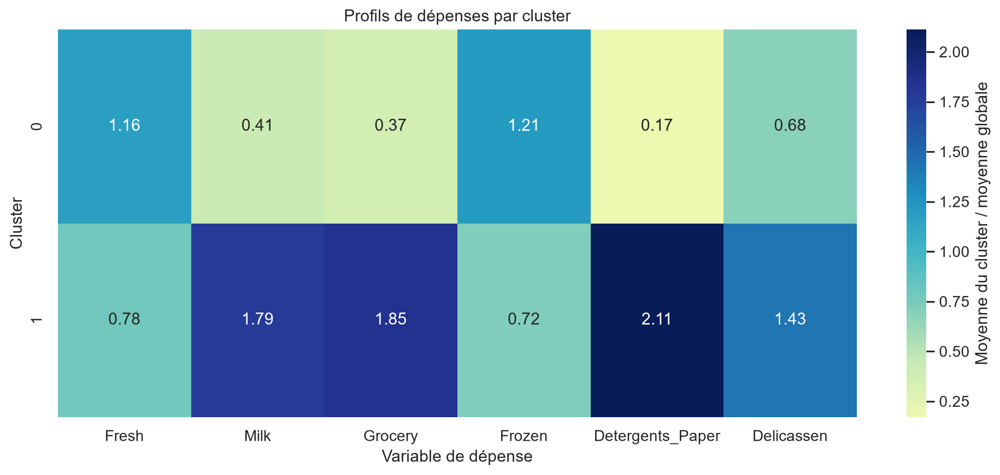

# Customer Segmentation using Unsupervised Machine Learning

**Segmentation intelligente des clients d'un distributeur en gros — étude comparative de K-Means, CAH et DBSCAN**

Projet académique de **Machine Learning 2** réalisé par des étudiants ingénieurs de l'ENSAM Rabat.

## Project Overview

Un distributeur en gros peut servir des commerces, des hôtels ou des restaurants ayant des comportements d'achat différents. Ce projet cherche à découvrir des groupes de clients présentant des profils de dépenses similaires, sans disposer de labels commerciaux préexistants.

L'approche est un apprentissage non supervisé : les algorithmes construisent des groupes à partir des six variables de dépenses. Les segments sont ensuite décrits dans l'échelle originale et comparés avec `Channel` et `Region`, qui sont réservées à l'interprétation.

Le prétraitement principal utilisé pour les distances est `log1p + StandardScaler`. Les trois méthodes implémentées sont K-Means, la Classification Ascendante Hiérarchique (CAH) avec liaison Ward et DBSCAN.

## Dataset Description

Le dataset **Wholesale Customers** provient de l'[UCI Machine Learning Repository, dataset 292](https://archive.ics.uci.edu/dataset/292/wholesale+customers). Il contient **440 clients** et **8 colonnes**.

| Variable | Signification | Type dans l'analyse | Utilisation |
|---|---|---|---|
| `Channel` | Canal commercial codé | Catégorielle | Interprétation uniquement |
| `Region` | Région du client codée | Catégorielle | Interprétation uniquement |
| `Fresh` | Dépenses annuelles en produits frais | Numérique quantitative | Clustering |
| `Milk` | Dépenses annuelles en produits laitiers | Numérique quantitative | Clustering |
| `Grocery` | Dépenses annuelles en épicerie | Numérique quantitative | Clustering |
| `Frozen` | Dépenses annuelles en produits surgelés | Numérique quantitative | Clustering |
| `Detergents_Paper` | Dépenses annuelles en détergents et papier | Numérique quantitative | Clustering |
| `Delicassen` | Dépenses annuelles en produits delicatessen | Numérique quantitative | Clustering |

Aucune unité monétaire n'est ajoutée. Le CSV original est conservé dans [data/raw/Wholesale customers data.csv](data/raw/Wholesale%20customers%20data.csv).

## Project Architecture

~~~text
ML2-Customer-Segmentation/
├── data/
│   ├── raw/
│   │   └── Wholesale customers data.csv
│   └── processed/
│       ├── customers_standard_scaled.csv
│       ├── customers_log_standard_scaled.csv
│       ├── customers_log_robust_scaled.csv
│       └── preprocessing_transformers.pkl
├── models/
│   └── kmeans_final.pkl
├── notebooks/
│   ├── 01_dataset_understanding.ipynb
│   ├── 02_exploratory_data_analysis.ipynb
│   ├── 03_data_preprocessing.ipynb
│   ├── 04_kmeans_clustering.ipynb
│   └── 05_cah_dbscan_comparison.ipynb
├── results/
│   ├── figures/
│   │   ├── 01_histogrammes_kde_depenses.png
│   │   ├── 02_boxplots_depenses_iqr.png
│   │   ├── 03_heatmap_correlations_depenses.png
│   │   ├── 04_scatterplots_relations_depenses_channel.png
│   │   ├── 05_repartition_channel_region.png
│   │   ├── 06_comparaison_depenses_par_channel.png
│   │   ├── 07_preprocessing_distributions_comparison.png
│   │   ├── 08_preprocessing_boxplots_comparison.png
│   │   ├── 09_kmeans_elbow.png
│   │   ├── 10_kmeans_silhouette.png
│   │   ├── 11_kmeans_cluster_profiles_heatmap.png
│   │   ├── 12_kmeans_cluster_means.png
│   │   ├── 13_kmeans_pca_projection.png
│   │   ├── 14_cah_dendrogramme_ward.png
│   │   ├── 15_cah_silhouette.png
│   │   ├── 16_dbscan_grid_results.png
│   │   ├── 17_comparison_silhouette.png
│   │   └── 18_profiles_methods_original.png
│   └── tables/
│       ├── cah_search_metrics.csv
│       ├── cluster_profiles_all_methods_original.csv
│       ├── comparison_kmeans_cah_dbscan.csv
│       ├── dbscan_grid_metrics.csv
│       ├── kmeans_centroids_prepared.csv
│       ├── kmeans_client_labels.csv
│       ├── kmeans_cluster_channel_region.csv
│       ├── kmeans_cluster_profiles_original.csv
│       ├── kmeans_pca_coordinates.csv
│       └── kmeans_search_metrics.csv
├── src/
│   ├── check_dataset.py
│   └── preprocessing.py
├── .vscode/
│   └── settings.json
├── .gitignore
├── README.md
└── requirements.txt
~~~

- `data/raw/` contient le dataset source intact.
- `data/processed/` contient les trois matrices préparées et les transformateurs sauvegardés.
- `notebooks/` contient les analyses exécutées dans l'ordre.
- `results/figures/` contient les graphiques exportés de l'EDA, du prétraitement et du clustering.
- `results/tables/` contient les métriques, labels, centroïdes et profils des clusters.
- `models/` contient le modèle K-Means final sauvegardé.
- `src/` contient les scripts de contrôle et de prétraitement réutilisables.
- `.vscode/` contient la configuration locale recommandée pour VS Code.

## Installation and Setup

### Prérequis

- Windows PowerShell ;
- Python 3.12 ;
- Git ;
- Visual Studio Code avec les extensions Python et Jupyter.

### Installation sous PowerShell

~~~powershell
git clone https://github.com/saadshr/ml2-customer-segmentation.git
cd ml2-customer-segmentation

& "C:\Program Files\Python312\python.exe" -m venv .venv
.\.venv\Scripts\Activate.ps1

python -m pip install -r requirements.txt
~~~

Si l'activation PowerShell est bloquée pour la session courante :

~~~powershell
Set-ExecutionPolicy -Scope Process -ExecutionPolicy Bypass
.\.venv\Scripts\Activate.ps1
~~~

L'environnement peut aussi être utilisé directement sans activation :

~~~powershell
& ".\.venv\Scripts\python.exe" -m pip install -r requirements.txt
& ".\.venv\Scripts\jupyter.exe" notebook
~~~

Dans VS Code, sélectionner `.venv\Scripts\python.exe` comme interpréteur et `Python 3.12 (.venv)` comme kernel des notebooks.

## Execution Order

Depuis la racine du dépôt :

~~~powershell
& ".\.venv\Scripts\python.exe" src\check_dataset.py
& ".\.venv\Scripts\jupyter.exe" nbconvert --to notebook --execute --inplace notebooks\01_dataset_understanding.ipynb
& ".\.venv\Scripts\jupyter.exe" nbconvert --to notebook --execute --inplace notebooks\02_exploratory_data_analysis.ipynb
& ".\.venv\Scripts\jupyter.exe" nbconvert --to notebook --execute --inplace notebooks\03_data_preprocessing.ipynb
& ".\.venv\Scripts\jupyter.exe" nbconvert --to notebook --execute --inplace notebooks\04_kmeans_clustering.ipynb
& ".\.venv\Scripts\jupyter.exe" nbconvert --to notebook --execute --inplace notebooks\05_cah_dbscan_comparison.ipynb
~~~

Les sorties sont conservées dans les notebooks et les fichiers produits dans `data/processed/`, `results/` et `models/`. Le CSV original n'est pas modifié.

## Machine Learning Pipeline

~~~mermaid
flowchart LR
    A[Dataset] --> B[Data Understanding ✅ terminé]
    B --> C[EDA ✅ terminée]
    C --> D[Preprocessing ✅ terminé]
    D --> E[Clustering ✅ terminé]
    E --> F[Evaluation ✅ terminée]
    F --> G[Customer Profiling ✅ réalisé]
    G --> H[Conclusions prudentes ✅ documentées]
~~~

## Algorithms

| Méthode | Principe | Atout | Limite observée |
|---|---|---|---|
| **K-Means** | Affecte les clients au centroïde le plus proche et minimise l'inertie. | Simple, reproductible et couverture complète. | Nécessite `K` et préfère des groupes compacts. |
| **CAH Ward** | Fusionne progressivement les groupes en contrôlant l'augmentation de variance. | Dendrogramme interprétable. | Dépend du linkage et du choix de `K`. |
| **DBSCAN** | Forme des groupes selon la densité et identifie les points de bruit. | Peut isoler les observations atypiques. | Très sensible à `eps` et `min_samples`. |

Les trois méthodes sont implémentées dans les notebooks 04 et 05. Les numéros de clusters ne sont pas comparables directement entre méthodes.

## Results

Les métriques ci-dessous proviennent des exécutions réelles sur les six variables préparées.

| Méthode | Clusters | Silhouette | Points évalués | Couverture | Bruit | Effectifs |
|---|---:|---:|---:|---:|---:|---|
| K-Means | 2 | 0,2903 | 440 | 100 % | 0 % | 252, 188 |
| CAH Ward | 2 | 0,2585 | 440 | 100 % | 0 % | 178, 262 |
| DBSCAN (`eps=0,80`, `min_samples=5`) | 3 | 0,2885* | 210* | 47,73 % | 52,27 % | 200, 5, 5 |

`*` Pour DBSCAN, la silhouette est calculée uniquement sur les 210 points non bruités. Elle n'est donc pas directement comparable aux scores K-Means et CAH calculés sur les 440 clients. Une configuration DBSCAN obtenant une silhouette plus élevée mais une couverture très faible n'est pas retenue comme meilleur compromis.

### Conclusion scientifique

Parmi les configurations testées, **K-Means est retenu comme le meilleur compromis** : il couvre les 440 clients, produit deux groupes de taille raisonnable et obtient la meilleure silhouette complète (**0,2903**). La CAH Ward donne une partition proche mais légèrement moins bien séparée (**0,2585**). DBSCAN est utile pour révéler des observations considérées comme du bruit, mais sa configuration analysée exclut **52,27 %** des clients ; son score hors bruit doit donc être interprété avec prudence.

La silhouette de K-Means reste modeste. Elle suggère une séparation limitée ou des profils qui se recouvrent partiellement ; elle ne doit pas être présentée comme une segmentation parfaite. Les résultats sont des supports d'analyse exploratoire et ne prouvent aucune causalité commerciale.

## Exploratory Data Analysis

L'EDA a été réalisée dans [02_exploratory_data_analysis.ipynb](notebooks/02_exploratory_data_analysis.ipynb). Les dépenses présentent des asymétries positives et des valeurs extrêmes potentielles. Les corrélations les plus fortes observées sont `Grocery`–`Detergents_Paper` (**0,925**), `Milk`–`Grocery` (**0,728**) et `Milk`–`Detergents_Paper` (**0,662**). Ces associations ne démontrent pas de causalité.

### Figures principales

## Evaluation Details

Les notebooks utilisent principalement :

- **Silhouette Score** pour la cohésion et la séparation ;
- **inertie et méthode du coude** pour K-Means ;
- **effectifs et couverture** pour vérifier qu'une solution n'est pas dominée par un groupe minuscule ou par le bruit ;
- **profils moyens dans l'échelle originale** pour l'interprétation commerciale.

Les scores DBSCAN sont toujours accompagnés du nombre de points évalués. Cette précaution évite de comparer directement une silhouette calculée sur un sous-ensemble avec une silhouette calculée sur les 440 clients.

## Reproducibility

- Environnement : Python 3.12 dans `.venv`.
- Dépendances : [requirements.txt](requirements.txt).
- Source : [data/raw/Wholesale customers data.csv](data/raw/Wholesale%20customers%20data.csv).
- Prétraitement principal : `log1p + StandardScaler`.
- K-Means : `init="k-means++"`, `n_init=20`, `random_state=42`.
- Les chemins utilisés dans les notebooks sont construits à partir de la racine du projet et restent relatifs au dépôt.
- L'ordre d'exécution recommandé est celui présenté dans [Execution Order](#execution-order).

## Limitations and Future Work

Le dataset contient 440 clients et six catégories de dépenses, mais peu de variables explicatives métier. Les dépenses sont agrégées annuellement, les catégories `Channel` et `Region` sont codées, et la silhouette montre une séparation modeste.

Les prolongements possibles sont l'analyse de sensibilité des hyperparamètres, la comparaison de plusieurs prétraitements, l'étude plus détaillée des profils et la validation métier des segments. Toute interprétation doit rester descriptive et être confirmée par le contexte commercial.

## References

- [UCI Machine Learning Repository — Wholesale Customers, ID 292](https://archive.ics.uci.edu/dataset/292/wholesale+customers)
- [Scikit-learn — Clustering](https://scikit-learn.org/stable/modules/clustering.html)
- [Scikit-learn — Clustering metrics](https://scikit-learn.org/stable/modules/clustering.html#clustering-performance-evaluation)
- [SciPy — Hierarchical clustering](https://docs.scipy.org/doc/scipy/reference/cluster.hierarchy.html)
- [Pandas documentation](https://pandas.pydata.org/docs/)
- [Seaborn documentation](https://seaborn.pydata.org/)

## Authors

Projet réalisé par des étudiants ingénieurs de l'**ENSAM Rabat**.

Membres du groupe :

- Saad Sahraoui
- Hassan El Hajjam
